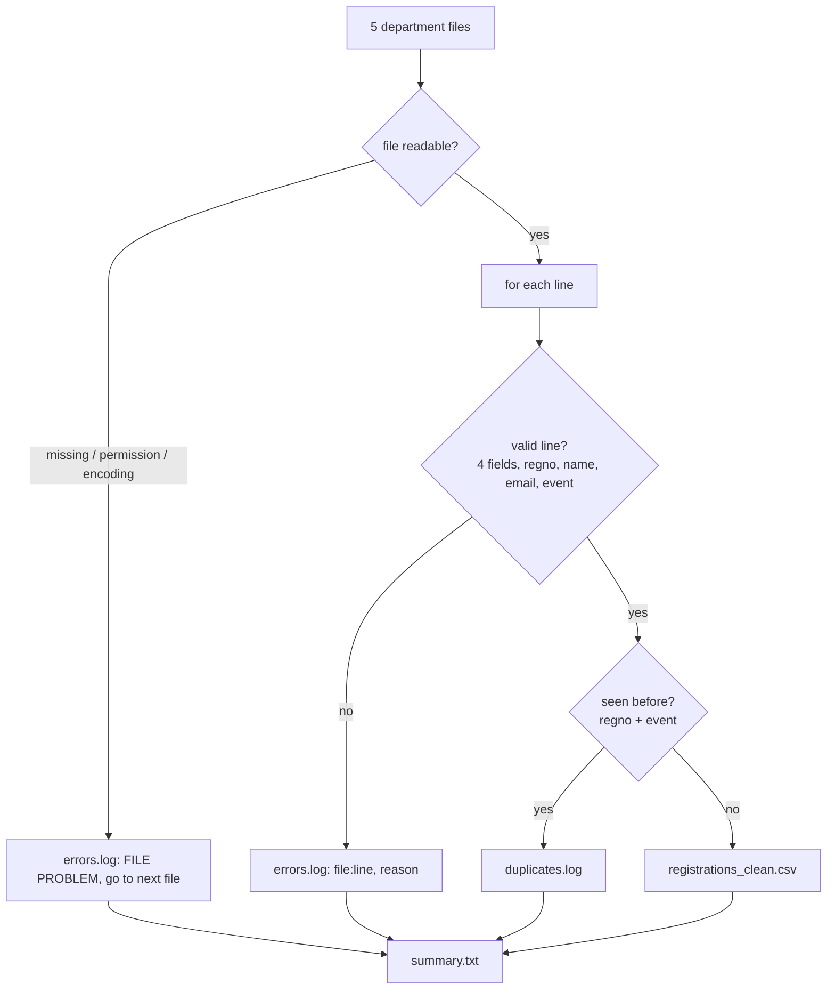

# Task 6 – Design Challenge: College Fest Registration Desk (K5)

**Run (inside this folder):**
```
python demo_all.py          # Stage 5: the 5 scenarios + the combined set, summaries and logs
python run_fest.py          # the real program on data/full  (optional: python run_fest.py <input_folder> <output_folder>)
python test_fest.py         # 47 assert-based checks
python -m fest data/full output/x     # the package can also be run as a module
```
Package `fest/`: `__init__.py`, `errors.py`, `reader.py`, `validator.py`, `writer.py`, `pipeline.py`, `__main__.py`. Data: `data/<scenario>/<DEPT>.txt` (`clean`, `duplicate`, `bad_email`, `damaged`, `missing_file`, `full`).

## Stage 1 – Interpret the problem
**Inputs:** five department files `CSE.txt, ECE.txt, MECH.txt, CIVIL.txt, EEE.txt`, UTF-8, one registration per line: `regno;name;email;event` (semicolon-separated).
**Outputs** (in the output folder, rebuilt on every run):
| File | Content |
|---|---|
| `registrations_clean.csv` | `regno;name;email;event;department` – valid, de-duplicated, normalised registrations |
| `duplicates.log` | each removed duplicate, with the place of the first registration |
| `errors.log` | each invalid/damaged line (file:line, reason, text) and each missing/unreadable department file |
| `summary.txt` | per-department counts and registrations per event |
**Testable requirements** (each is checked in `test_fest.py` / `demo_all.py`):
1. A clean set gives every line in the clean file and empty logs (10 of 10).
2. The same student registering twice for the same event (any case/spacing, in one or two departments) is kept once; the others go to `duplicates.log`. The same student for a *different* event is **not** a duplicate.
3. An invalid e-mail rejects only that line, which is logged with the reason (8 invalid e-mail forms tested).
4. A damaged line (wrong number of fields, bad register number, empty line, empty name/event) is logged and skipped.
5. A missing/unreadable/wrongly-encoded department file is logged and the other four files are still processed.
6. **The program never crashes** on bad data and always produces all four output files.
7. Accepted + duplicates + invalid = number of non-missing lines (nothing disappears silently).

## Stage 2 – Processing flow

Text version: input files → read each file (file-level errors are logged, run continues) → for each line: validate (invalid → `errors.log`) → duplicate test with a set/dict (duplicate → `duplicates.log`) → accepted → `registrations_clean.csv` → finally `summary.txt`.

## Stage 3 – Critical design decisions
**Duplicate detection:** a duplicate is the **same register number for the same event** (event compared case-insensitively after trimming). A dictionary `first_seen[(regno, event)] = "CSE.txt:3"` is filled as lines are accepted; membership test is O(1) on average, so 150,000 lines are as easy as 15. The **first** registration is kept (files are read in the fixed order CSE, ECE, MECH, CIVIL, EEE), later ones are logged with the position of the first. Different event = a different registration; same student in two departments for the same event is also a duplicate.
**Validating e-mails with string methods only** (`validator.is_valid_email`, no regular expression): exactly one `@` (`count`); no space; local part and domain non-empty (`split`); local part only letters/digits/`._%+-` (`isalnum`) and not starting/ending with `.` or containing `..` (`startswith`, `endswith`, `in`); domain contains `.`, no empty label (`split(".")`), labels made of letters/digits/`-`; last label at least 2 letters (`len`, `isalpha`). Tested: accepts 5 valid forms, rejects 18 invalid forms (e.g. `a@b`, `a@@b.com`, `@b.com`, `a b@c.com`, `a@b.c`, `a@.b.com`, `a..b@c.com`). The address is lower-cased first, so `ISHAAN@College.EDU` is accepted as `ishaan@college.edu`. Limitation: it does not check that the mailbox exists or reject every address the full RFC would reject.
**Exception handling – two levels:**
- *line-level* `InvalidRegistration(line_no, text, reason)` – raised by `validate_line`, caught in `pipeline.run` inside the line loop → `errors.log`, next line.
- *file-level* `DepartmentFileError` – raised by `reader.read_department` with `raise … from e` (`FileNotFoundError`, `PermissionError`, `IsADirectoryError`, `UnicodeDecodeError` are translated and the original is kept as `__cause__`) → caught in `run`, logged, next department.
- *Output problems* (`OSError` when writing) → clear message, exit code 2. The **only broad `except Exception`** is the last line of defence in `run_fest.py`: it writes the full traceback to `fatal_error.log` and exits with code 3 – it never uses `pass`.
Files are always opened with `with` and `encoding="utf-8"`; outputs use `"w"` because the whole set is re-processed on each run (an old log must not be mixed with a new one).

## Stage 4 – Package design
```
Task6/
├── run_fest.py            command line (guards + the last-line-of-defence handler)
├── demo_all.py            stage 5 demonstration
├── test_fest.py           47 checks
├── fest/
│   ├── __init__.py        package docstring (imports nothing)
│   ├── __main__.py        python -m fest
│   ├── errors.py          InvalidRegistration, DepartmentFileError
│   ├── reader.py          read_department(path) -> [(line_no, text)]
│   ├── validator.py       is_valid_email, validate_line, duplicate_key
│   ├── writer.py          write_clean, write_log, write_summary
│   └── pipeline.py        run(input_dir, output_dir) – the flow
└── data/<scenario>/<DEPT>.txt
```
Why a package: each module has one job (reading, validating, writing), `validator` can be unit-tested without any file, the output format can change without touching validation, and `from fest import ...` cannot clash with other modules named `reader` or `writer`.
**Pseudocode – reading**
```
FUNCTION read_department(path)
    SET lines TO empty list
    TRY
        OPEN path as UTF-8
        FOR each line WITH line_number
            ADD (line_number, line without newline) TO lines
        ENDFOR
    EXCEPT file not found / permission denied / is a folder / bad encoding
        RAISE DepartmentFileError describing the problem, keeping the original error as its cause
    ENDTRY
    RETURN lines
```
**Pseudocode – validating**
```
FUNCTION validate_line(line, line_number)
    SET text TO line without surrounding spaces
    IF text is empty THEN RAISE InvalidRegistration "empty line"
    SPLIT text on ';' INTO parts and trim each part
    IF number of parts is not 4 THEN RAISE InvalidRegistration "wrong number of fields"
    IF regno is not exactly 9 digits THEN RAISE InvalidRegistration
    IF name is empty THEN RAISE InvalidRegistration
    SET email TO lower case of email
    IF email is not valid (one '@', no space, local part ok, domain with '.', last label >= 2 letters) THEN RAISE InvalidRegistration
    IF event is empty THEN RAISE InvalidRegistration
    RETURN record with normalised name (Title Case), email, event
```
**Pseudocode – writing and the main flow**
```
FUNCTION run(input_dir, output_dir)
    SET clean, duplicates, errors TO empty lists ; SET first_seen TO empty dictionary
    FOR each department IN [CSE, ECE, MECH, CIVIL, EEE]
        TRY read_department
        EXCEPT DepartmentFileError  -> ADD message TO errors ; CONTINUE with the next department
        FOR each (line_number, text)
            TRY validate_line
            EXCEPT InvalidRegistration -> ADD reason TO errors ; CONTINUE
            IF (regno, event) IS IN first_seen THEN ADD to duplicates ; CONTINUE
            SET first_seen[(regno, event)] TO "file:line" ; ADD record TO clean
        ENDFOR
    ENDFOR
    WRITE registrations_clean.csv, duplicates.log, errors.log, summary.txt (each with 'with', UTF-8, mode "w")
```

## Stage 5 – Demonstration (output of `demo_all.py`)
| Scenario (folder) | Accepted | Duplicates | Invalid lines | Files lost | What it shows |
|---|---|---|---|---|---|
| Clean files (`clean`) | 10 | 0 | 0 | 0 | all lines pass; logs empty; counts per event |
| Duplicate registration (`duplicate`) | 7 | 2 | 0 | 0 | `CSE.txt:2` (same event typed `  dance`) and `ECE.txt:1` (`SINGING` already in CSE) removed; same student for a *second event* kept |
| Invalid e-mail (`bad_email`) | 5 | 0 | 8 | 0 | `arun.college.edu`, `bhavana@@college.edu`, `chitra@college`, `@college.edu`, `elan @college.edu`, `fathima@college.e`, `gopi@.college.edu`, `hema..d@college.edu` rejected with the reason; `ISHAAN@College.EDU` accepted (lower-cased) |
| Damaged line (`damaged`) | 6 | 0 | 7 | 0 | 3 fields, 5 fields, `abc` as register number, empty line, `;;;`, empty name, blank line |
| Missing department file (`missing_file`) | 8 | 0 | 0 | 1 | `EEE.txt: FILE PROBLEM - file not found (cause: FileNotFoundError)`; the other four are processed; summary shows `MISSING` |
| Everything together (`full`) | 9 | 2 | 5 | 1 | all of the above in one run (hand check: CSE 3 valid+1 dup+2 invalid of 6 lines; ECE 2+1+2 of 5; MECH 2+0+1 of 3; CIVIL 2 of 2; EEE missing) |
All six runs finished without a crash and wrote all four output files. Beyond the scenarios, `test_fest.py` also checks a wrongly encoded file, a *folder* named like a department file, and an empty input folder (all five files reported, no exception).
